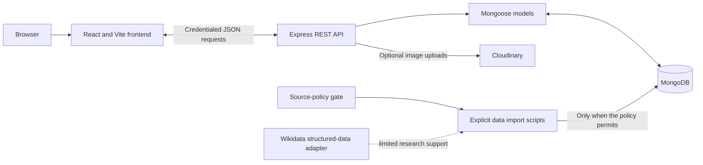

# World of Cultures

- **Live Application:** [world-of-cultures.vercel.app](https://world-of-cultures.vercel.app)
- **API Server:** [world-of-cultures.onrender.com/api](https://world-of-cultures.onrender.com/api)
- **Demo Video:** [Watch Demonstration (Google Drive)](https://drive.google.com/file/d/1q4yMeYfVRMI7OCKfj7JMpwZS9PXy3IJ4/view?usp=sharing)
- **Repository:** [github.com/Hitesh14477/world-of-cultures](https://github.com/Hitesh14477/world-of-cultures)

## Table of Contents

- [Project Name](#project-name)
- [Problem Statement](#problem-statement)
- [Target Users](#target-users)
- [Solution](#solution)
- [Demo Video](#demo-video)
- [Key Features](#key-features)
- [User-Contributed Cultural Knowledge](#user-contributed-cultural-knowledge)
- [Tech Stack](#tech-stack)
- [Architecture](#architecture)
- [Local Setup](#local-setup)
- [Environment Variables](#environment-variables)
- [Deployment](#deployment)
- [Project Structure](#project-structure)
- [API Overview](#api-overview)
- [Testing](#testing)
- [Future Improvements](#future-improvements)
- [License](#license)
- [Administrator Review](#administrator-review)
- [User Accounts and Favourites](#user-accounts-and-favourites)
- [Country Data and Research](#stage-2-country-data)
- [Community Photo Sharing](#community-photo-sharing)

## Project Name

**World of Cultures** is a MERN application that helps people discover countries and explore cultural heritage through one platform. Users can browse country information, read published cultural records, and take part in a moderated contribution and community experience.

## Problem Statement

Information about a country's history, food, festivals, languages, music, customs, and places is spread across many sites and resources. Exploring a culture often means searching several sources and piecing together information in different formats. User submissions also need editorial review before they are presented as published reference material.

World of Cultures aims to make this exploration more convenient by organizing country information and reviewed cultural contributions in one accessible application.

## Target Users

- Students researching countries and cultures.
- Travellers interested in cultural traditions and destinations.
- People curious about world history, customs, languages, and lifestyles.
- Members who want to share cultural knowledge, save content, or participate in the community.
- Administrators who review cultural and place submissions and moderate community posts.

## Solution

World of Cultures provides a central website for browsing country profiles, searching published cultural entries and places, saving favourites, and sharing community posts. Members can submit cultural entries and places with references and an image. Those submissions remain unpublished until an administrator reviews and approves them.

The application implements the submission form, pending-review queue, approval/publication, rejection with an optional reason, and contributor status display. It does not currently implement a request-changes decision or contributor editing/resubmission of a rejected record. Other ideas in this README are labelled as future work where applicable.

## Demo Video

- 📹 **Walkthrough and Feature Demonstration:** [Watch Video on Google Drive](https://drive.google.com/file/d/1q4yMeYfVRMI7OCKfj7JMpwZS9PXy3IJ4/view?usp=sharing)

## Key Features

- Browse country profiles and filter the directory by continent or search term; inspect flags, geography, and available country facts.
- Search country names and supported facts, published cultural entries, and places with country, continent, region, type, and category filters.
- Read published cultural records with their references and image attribution where provided.
- Register and sign in, manage profile details, and save countries or published cultural/place records to My Collection.
- Create community photo posts, browse and filter posts by country, like and unlike posts, comment, and visit public member profiles.
- Submit cultural entries and places with a country, category, written content, an image, and at least one source.
- Review pending entries and places in the protected administrator dashboard; approve and publish them or reject them with an optional reason.

Content availability depends on records present in the configured MongoDB database. The repository does not contain a comprehensive, ready-to-publish cultural dataset; see [Country Data and Research](#stage-2-country-data).

## User-Contributed Cultural Knowledge

Members can contribute country-specific cultural entries about history, traditional food, festivals, traditional clothing, customs and traditions, languages and dialects, mythology and folklore, music and dance, and everyday life. They can also submit places such as landmarks, heritage sites, cultural destinations, museums, and natural sites. Submissions include written information, at least one source, and an image with the required rights confirmation.

The implemented publication workflow is:

1. **User submission:** A signed-in member submits a cultural entry or place through the contribution form.
2. **Pending review:** The server stores it with `reviewStatus: "pending_review"`. It remains private; public country and search endpoints return only published cultural entries and places.
3. **Administrator review:** An administrator opens the pending queue and reviews the content, references, image, and attribution. Approval is blocked if the stored image does not meet the required checks.
4. **Approval and publication:** The administrator can choose **Approve and publish**. The record becomes `published`, appears in public views, and the contributor receives a notification.
5. **Rejection:** The administrator can choose **Reject**, with an optional reason of up to 1,000 characters. The record becomes `rejected` and stays private; the contributor is notified and can see the status in My Contributions.

There is currently no **Request changes** action, revision status, contributor edit flow, or resubmission transition for a rejected entry. Rejected contributions cannot be sent back to pending review in the implemented dashboard. The workflow therefore supports approval/publication or rejection, not a revision cycle.

## Tech Stack

- **Frontend:** React 19, Vite 8, Axios, Tailwind CSS v4 Vite tooling, and Lucide React icons.
- **Backend:** Node.js 20.19+ or 22.12+, Express 5, and Mongoose 9.
- **Database:** MongoDB for country and cultural records, accounts, favourites, community posts, comments, likes, notifications, and shared authentication state.
- **Authentication and security:** Separate regular-user and administrator sessions, signed `HttpOnly` cookies, CSRF checks on state-changing requests, scrypt password hashes, server-side authorization, and MongoDB-backed session/throttle state.
- **External integrations:** Cloudinary for community and cultural/place submission image uploads. A backend Gemini draft helper and data-research/import scripts exist, but Gemini is not exposed by the current frontend/API; import operations are guarded by source-policy checks.
- **Development and deployment:** npm prefix-based scripts, ESLint, Node's built-in test runner, Docker Compose, and Nginx.

## Architecture

The React single-page application is built by Vite and calls the Express JSON API using credentialed requests. Express registers country, search, account, community, and administrator route groups, with validation and authentication enforced in route middleware and controllers. Mongoose models persist content and user data in MongoDB. Published cultural queries are filtered on the server; pending submissions are available only to authorized reviewers. Authentication sessions and login-throttle state are stored in the shared MongoDB `auth_state` collection so multiple API instances can use the same state. In the included deployment, Nginx serves the frontend and proxies `/api` requests to the private Express service.



Cloudinary is used only when configured for community photo uploads. Import scripts do not run at application startup; current source-policy gates prevent the blocked persistent country/UNESCO imports described below. The adapter and importers are not a live data feed to the frontend.

Main API route groups include `GET /api/countries`, `GET /api/search`, `POST /api/users/register`, `POST /api/users/login`, `GET /api/users/session`, `/api/users/me/*` account endpoints, `/api/community` feed and post endpoints, and `/api/admin/*` login and moderation endpoints. See the endpoint sections below for parameters and protections.

## Local Setup

### Requirements

- Node.js 20.19+ (or 22.12+) and npm
- MongoDB running locally, or a MongoDB connection string

### Start locally

1. Clone the repository and enter its directory:

   ```sh
   git clone https://github.com/Hitesh14477/world-of-cultures.git
   cd world-of-cultures
   ```

2. Install root, frontend, and backend dependencies:

   ```sh
   npm install
   npm install --prefix frontend/vite-project
   npm install --prefix backend
   ```

3. Create local environment files from the safe examples if they do not already exist:

   ```sh
   test -f backend/.env || cp backend/.env.example backend/.env
   test -f frontend/vite-project/.env || cp frontend/vite-project/.env.example frontend/vite-project/.env
   ```

4. In `backend/.env`, set `MONGODB_URI` to your MongoDB connection string and replace the `USER_SESSION_SECRET` example with a private random value of at least 32 characters. To use administrator features, also set `ADMIN_USERNAME`, `ADMIN_SESSION_SECRET`, and provision `ADMIN_PASSWORD_HASH` using the command in [Administrator Review](#administrator-review). Do not commit either `.env` file.

5. Start MongoDB, then run both development servers from the repository root:

   ```sh
   npm run dev
   ```

   The frontend is at `http://localhost:5173`; the API is at `http://localhost:5001` and its health check is `http://localhost:5001/api/health`.

   To run either app separately, use two terminals from the repository root:

   ```sh
   npm run dev:backend
   npm run dev:frontend
   ```

   The equivalent package-level commands are `npm run dev --prefix backend` and `npm run dev --prefix frontend/vite-project`.

## Environment Variables

Copy the example files as described above. Keep real values in local or deployment secret storage; never commit them or place backend secrets in the frontend environment.

| Variable | Service | Required? | Purpose and safe example format |
| --- | --- | --- | --- |
| `MONGODB_URI` | Backend | Required for database-backed features | MongoDB URI, e.g. `mongodb://127.0.0.1:27017/world-of-cultures`. |
| `PORT` | Backend | Optional | API listen port; defaults to `5001`. Example: `5001`. |
| `NODE_ENV` | Backend | Optional | Set to `production` for production security checks and cookies. Example: `development`. |
| `FRONTEND_ORIGIN` | Backend | Required in production | Exact frontend origin with scheme and port, no path. Local default: `http://localhost:5173`. |
| `TRUST_PROXY_HOPS` | Backend | Optional | Number of known, sanitized proxy hops; defaults to `0`, included Nginx deployment uses `1`. Example: `1`. |
| `USER_SESSION_SECRET` | Backend | Required for regular-user authentication | Private random value of at least 32 characters; keep separate from the admin secret. Example: `<random-secret-32-or-more-characters>`. |
| `ADMIN_USERNAME` | Backend | Required to configure admin login | Administrator login name. Example: `<your-admin-name>`. |
| `ADMIN_PASSWORD_HASH` | Backend | Required to configure admin login | Scrypt hash written by `npm run admin:set-password --prefix backend`; never put a plaintext password here. |
| `ADMIN_SESSION_SECRET` | Backend | Required to configure admin login | Private random value of at least 32 characters, distinct from `USER_SESSION_SECRET`. |
| `CLOUDINARY_CLOUD_NAME` | Backend | Optional; required with the next two for uploads | Enables Community and cultural/place submission image uploads. Example: `<cloud-name>`. |
| `CLOUDINARY_API_KEY` | Backend | Optional; required with the other Cloudinary values | Server-side Cloudinary API key. Example: `<api-key>`. |
| `CLOUDINARY_API_SECRET` | Backend | Optional; required with the other Cloudinary values | Server-side Cloudinary secret. Example: `<api-secret>`. |
| `GEMINI_API_KEY` | Backend | Optional | Key for the backend-only draft-assistance service. Example: `<api-key>`. |
| `VITE_API_URL` | Frontend build | Optional | API base URL. Local example: `http://localhost:5001/api`; same-origin production example: `/api`. |
| `FRONTEND_PORT` | Frontend development | Optional | Vite port; defaults to `5173`. Example: `5173`. |
| `DOTENV_CONFIG_PATH` | Backend scripts | Optional | Alternate dotenv file path; defaults to `.env` in the command's working directory. |
| `REST_COUNTRIES_API_KEY` | Country import script | Not currently usable | Importer source credential, if required by the source. Current source-policy gate blocks this persistent import. Do not add a key to bypass the gate. |
| `COUNTRIES_SOURCE_FILE` | Country import script | Optional import input | Path to a complete saved source response. The same source-policy gate applies; an offline file is not a bypass. |
| `TLS_CERT_PATH`, `TLS_KEY_PATH` | Docker Compose host | Required for included HTTPS deployment | Paths to TLS certificate and private key files outside Git; defaults point to `deploy/certs/`. |
| `WEB_HTTP_PORT`, `WEB_HTTPS_PORT` | Docker Compose host | Optional | Published Nginx ports; defaults are `80` and `443`. |

The complete safe templates are [`backend/.env.example`](backend/.env.example) and [`frontend/vite-project/.env.example`](frontend/vite-project/.env.example). Local `.env` files are ignored by Git. Never copy real values into this README, frontend source, or a committed file. The country importer currently stops at its source-policy gate, regardless of whether an API key or saved response is configured.

## Deployment

- **Live Application (Vercel):** [https://world-of-cultures.vercel.app](https://world-of-cultures.vercel.app)
- **API Server (Render):** [https://world-of-cultures.onrender.com/api](https://world-of-cultures.onrender.com/api)
- **Demo Video:** [Watch Demonstration on Google Drive](https://drive.google.com/file/d/1q4yMeYfVRMI7OCKfj7JMpwZS9PXy3IJ4/view?usp=sharing)

To deploy on a Linux host with Docker and a MongoDB service, follow [Production deployment (Docker Compose)](#production-deployment-docker-compose) below. It builds the frontend and API containers and serves them through Nginx on ports 80/443; configure TLS files and production environment values before starting it. For a separate frontend/API platform deployment, follow the cross-origin hosting notes in that section and configure `FRONTEND_ORIGIN` and `VITE_API_URL` accordingly.

## Environment setup

The backend reads `MONGODB_URI`, `PORT`, `NODE_ENV`, `FRONTEND_ORIGIN`, `TRUST_PROXY_HOPS`, authentication secrets, and optional integration settings from `backend/.env`. The frontend reads `VITE_API_URL` from `frontend/vite-project/.env`.

For production, use HTTPS and either the included same-origin Nginx deployment or frontend/API subdomains under the same site. The Nginx setup serves the frontend and proxies `/api` to Express, so set `VITE_API_URL=/api`. For separate subdomains set `VITE_API_URL` to the API origin ending in `/api`. Production builds reject loopback API URLs. Set `FRONTEND_ORIGIN` to the exact frontend origin, including scheme and port but no path; production startup refuses to run without it. Cookies are host-only, `HttpOnly`, `Secure`, and `SameSite=Strict`; the frontend and API must be same-site for browser cookie authentication. Arbitrary cross-site deployments need a different cookie architecture.

Authentication sessions and failed-login counters use the application's MongoDB deployment. The `auth_state` collection stores users/admin sessions and per-client-IP login failure windows; a TTL index removes expired records. Production requests fail with HTTP 503 if this store cannot be reached, with no process-memory fallback. MongoDB must therefore be available for authentication. `TRUST_PROXY_HOPS` defaults to `0`; set it only to the known number of sanitized reverse proxies before Express. The supplied Nginx edge configuration overwrites forwarded client-IP headers and the Compose setup sets this to `1`.

Create local env files from the safe examples only when the files do not already exist:

```sh
test -f backend/.env || cp backend/.env.example backend/.env
test -f frontend/vite-project/.env || cp frontend/vite-project/.env.example frontend/vite-project/.env
```

If `backend/.env` already exists, keep it. Add or update `MONGODB_URI` there without sharing its value. The root `.gitignore` excludes local env files.

## Administrator review

The moderation API uses a server-verified administrator session. Set `ADMIN_USERNAME` and a unique `ADMIN_SESSION_SECRET` of at least 32 characters in `backend/.env`. Provision or replace the administrator password hash with the hidden-input command below; it updates only `ADMIN_PASSWORD_HASH` in the existing local env file and does not display the password or hash:

```sh
npm run admin:set-password --prefix backend
```

The password must be at least 14 characters. Keep `backend/.env` private and out of Git. The app uses Node's built-in scrypt password hashing, signed HttpOnly session cookies, MongoDB-backed session revocation, shared login throttles, and CSRF tokens for state changes. Production cookies are marked Secure. There is no public administrator-registration endpoint.

Administrator routes:

- `POST /api/admin/login` and `POST /api/admin/logout`
- `GET /api/admin/session` and `GET /api/admin/pending`
- `GET /api/admin/submissions/:type/:id`
- `POST /api/admin/submissions/:type/:id/approve` and `/reject`

The `:type` value is `cultural-entries` or `places`. All review routes require the administrator session; state-changing requests also require the session CSRF token. Approval changes a pending record to `published` after checking its stored image and makes it available through public country/search views. Rejection changes the status to `rejected`, keeps it private, and accepts an optional reason of up to 1,000 characters. The contributor receives a notification. There is no request-revision action or rejected-record resubmission endpoint.

Open `/admin/login` locally after setting up the backend environment to access the review dashboard. Pending records stay private; only approved and published records appear in the public country APIs.

## User accounts and favourites

Regular accounts use a separate `USER_SESSION_SECRET` in `backend/.env`; use a random value of at least 32 characters and keep it distinct from `ADMIN_SESSION_SECRET`. Regular accounts are self-registered by email and password. Passwords are hashed with Node's built-in asynchronous scrypt using a new random salt per account; no extra password package is required. Registration requires a password of at least 12 characters. There is no administrator role field or public way to grant administrator access.

An administrator session also has a separate, server-managed member profile so the signed-in administrator can contribute cultural content, post and interact in Community, use My Collection, and edit available member profile details. The profile is keyed by a private server-generated admin identity, has no public login credentials, and keeps the administrator's collection separate from regular users. Member actions validate the signed admin cookie and its CSRF token server-side; administrator review endpoints continue to require the administrator role check.

Regular user sessions use the `woc_user_session` HttpOnly cookie, separate from the administrator cookie. State-changing requests require the CSRF header and the configured frontend origin. The cookie is SameSite Strict and Secure in production. User accounts are not email-verified in this stage.

User endpoints:

- `POST /api/users/register`, `POST /api/users/login`, `POST /api/users/logout`, and `GET /api/users/session`
- `GET /api/users/me/favourites`, `POST /api/users/me/favourites`
- `GET /api/users/me/favourites/:type/:id` and `DELETE /api/users/me/favourites/:type/:id`

Favourite `type` is `country`, `cultural-entry`, or `place`; country references use country slugs and cultural/place references use MongoDB identifiers. Users can only access their own collection. Cultural entries and places must be published when saved and are filtered again when the collection is read. Unique database indexes prevent duplicate favourites. No existing content records are modified.

Use `/register` or `/login` in the frontend; `/my-collection` shows saved items.

## Install dependencies

```sh
npm install
npm install --prefix frontend/vite-project
npm install --prefix backend
```

## Run the applications

Start both development servers from the root:

```sh
npm run dev
```

Or start either application in its own terminal:

```sh
npm run dev:frontend
npm run dev:backend
```

The frontend defaults to `http://localhost:5173`. The backend defaults to `http://localhost:5001` and exposes `GET /api/health`. Port 5001 avoids the macOS AirPlay service commonly using port 5000. If the frontend port is already in use, set `FRONTEND_PORT` and set the backend's `FRONTEND_ORIGIN` to the matching origin before starting both apps.

For local database setup, run MongoDB locally or create a database on a managed MongoDB service, then set its connection string in the private `backend/.env` as `MONGODB_URI`. The app connects on backend startup; `GET /api/health` reports `503` while MongoDB is unavailable. The same database stores application records and expiring authentication state. Do not run data imports as part of deployment.

## Production deployment (Docker Compose)

The included `Dockerfile`, `compose.yaml`, and `deploy/nginx.conf` provide a single-origin deployment for a Linux host with Docker and an existing MongoDB service (for example MongoDB Atlas). Configure `backend/.env` from the example, use strong distinct session secrets, set `NODE_ENV=production`, set `FRONTEND_ORIGIN` to the public HTTPS site origin, and set `MONGODB_URI` to the production database. Configure `CLOUDINARY_*` if community uploads are enabled. Provide TLS files outside Git with `TLS_CERT_PATH` and `TLS_KEY_PATH` in the shell or a private root `.env` file. Then build and start:

```sh
docker compose build
docker compose up -d
```

The frontend is served by Nginx on ports 80 and 443 by default; HTTP redirects to HTTPS. Nginx proxies `/api` to the private backend and serves `index.html` for client-side routes. Do not expose the backend container directly. Nginx overwrites `X-Forwarded-For`, and `TRUST_PROXY_HOPS=1` trusts only that Nginx hop. If you place another ingress in front of Nginx, configure it and the Nginx real-IP trust list for its documented source ranges before relying on client-IP throttling. The deployment files do not contain credentials or provision MongoDB. No public deployment URL has been configured; add the HTTPS site URL here when the application is deployed.

For a managed static frontend and separate API service, use HTTPS hosts on the same registrable domain, set the frontend build's `VITE_API_URL` to the API `/api` URL, and set backend `FRONTEND_ORIGIN` to the exact frontend origin. Configure the platform's proxy trust only from its documented, sanitized forwarding behavior.

## Testing

```sh
npm run lint:frontend
npm run build:frontend
npm test --prefix backend
node --test frontend/vite-project/src/services/*.test.js
node --test backend/tests/community.test.js
```

The frontend uses ESLint and Node's built-in test runner for service-level logic. The backend uses Node's built-in test runner for models, route behavior, authentication, and API workflows. The API tests do not require a live MongoDB database; HTTP integration tests start a local listener, so the environment must allow binding to `127.0.0.1`.

The health endpoint returns the API status and MongoDB status. Its HTTP status is `200` when MongoDB is connected and `503` when the database is disconnected. The API process can still start without MongoDB so the health response remains available. If the initial MongoDB connection fails, correct the URI or start MongoDB and restart the backend; Mongoose does not automatically retry a failed initial connection.

## Project structure

```text
.
├── frontend/vite-project/
│   ├── src/
│   │   ├── components/       # Shared navigation, flags, notifications, and UI components
│   │   ├── pages/            # Country, contribution, search, community, account, and admin pages
│   │   ├── services/         # Credentialed API client and route/auth helpers with tests
│   │   ├── App.jsx           # Client-side route selection and shared application shell
│   │   └── App.css            # Application and responsive page styles
│   ├── .env.example          # Frontend build configuration example
│   └── vite.config.js
├── backend/
│   ├── src/
│   │   ├── config/           # MongoDB connection
│   │   ├── controllers/      # API business logic
│   │   ├── middleware/       # Authentication, authorization, and error handling
│   │   ├── models/           # Mongoose schemas
│   │   ├── routes/           # Country, search, user, community, and admin APIs
│   │   ├── scripts/          # Explicit import, reporting, and admin setup commands
│   │   ├── services/         # Auth state, media storage, imports, and notifications
│   │   └── validators/       # Cultural contribution validation
│   ├── tests/                # Node test-runner tests
│   ├── .env.example          # Backend configuration example
│   └── index.js              # API entry point
├── deploy/nginx.conf         # Same-origin HTTPS reverse proxy configuration
├── Dockerfile
├── compose.yaml
└── package.json              # Root development, lint, and build scripts
```

The tree omits individual model, controller, and test files for readability. All paths shown exist in the repository.

## Stage 2 country data

The Country model stores ISO identifiers, names, geography, demographics, flags, languages, currencies, time zones, and structured cultural sections with source metadata. Cultural sections start empty so later researched content can be added without the import overwriting it.

The optional import script targets the 193 United Nations member states and the two non-member observer states identified by ISO codes `VA` and `PS`. It validates the complete scope and all normalized records before connecting and writing; it never deletes records. Re-running it updates changed source facts by ISO code, preserves existing slugs and cultural content, and skips unchanged records. It does not run automatically.

Import scripts are protected by `backend/src/services/importPolicyRegistry.js` and `importPolicyGate.js`. The country importer is currently blocked: the recorded REST Countries terms permit only short-lived caching, and no permission for persistent database storage is approved. The gate runs before remote fetches, offline-file reads, or database connections. The cultural pilot importer is also blocked because the UNESCO source policies and persistent import operation have not been verified and approved. Existing data is not affected by the gate.

Run the explicit import only when you are ready:

```sh
npm run import:countries --prefix backend
```

These commands will stop at the source-policy gate until the registry is updated with current evidence that explicitly permits the relevant use, storage mode, retention, and attribution. An API key or public endpoint alone is not that evidence. Do not use an offline snapshot to bypass the gate.

## Cultural content coverage and batches

`npm run report:cultural-coverage --prefix backend` performs read-only counts across the countries, cultural entries, and places currently in MongoDB. It reports published coverage for the nine `CulturalEntry` categories plus `places`, status totals, and missing topics per country. It returns metadata only, not article text or moderation notes.

The cultural pilot importer accepts bounded country batches, for example `npm run import:cultural-pilot --prefix backend -- --dry-run --countries=india,japan`. To select only candidates from one registered source policy, add `--source-id=wikidata-structured-data`; this excludes the existing UNESCO candidates, whose policies remain unverified. The batch selector accepts up to 20 country slugs that have researched candidate records in the script's manifest. Candidates are validated against the existing models, resolved by country slug, checked by stable source key and natural key, and proposed as `pending_review`. Re-running an already processed batch skips matching records rather than overwriting them. Use small country batches as the researched manifest grows; do not fill gaps with generated or unsupported claims.

UNESCO source policies remain unverified, so candidates using those sources are blocked. Wikidata structured data has a narrowly scoped, evidence-linked policy for referenced structured facts only. The cultural importer still fails closed for any candidate whose source policy is missing, unverified, expired, lacks an explicitly approved operation, or whose source license metadata does not match the verified policy.

## Community photo sharing

The Community page is a separate user-generated photo feed; posts are not CulturalEntry records and are not treated as verified cultural information. The feed starts empty and is populated only by user submissions. Sign in to create, edit, or remove your own post. Community photos use Cloudinary storage through the backend and are limited to JPEG, PNG, or WebP up to 5 MB.

Configure `CLOUDINARY_CLOUD_NAME`, `CLOUDINARY_API_KEY`, and `CLOUDINARY_API_SECRET` in `backend/.env` for uploads. The values are server-only; do not add them to frontend environment files or commit them. If these variables are absent, post creation returns a configuration error rather than storing files locally. The backend environment template contains empty placeholders.

Administrators can edit or remove a published community post through `PATCH` or `DELETE /api/community/moderation/:id`, protected by the existing separate administrator session and CSRF check. Likes are authenticated and idempotent; comments are public to read and authenticated to add, with removal limited to the comment author, post owner, or administrator. A community reports queue and restoration workflow are not implemented.

Run the focused API tests with `node --test tests/community.test.js` from `backend/`, or run the complete backend suite with `npm test --prefix backend`. Start the full project using the existing root development command.

### Structured cultural research

`backend/src/services/wikidataResearch.js` is a mock-testable Wikidata structured-fact adapter. The registry permits only the specifically listed persistent structured-data research and cultural-pilot import operations. The adapter requires verified license metadata and externally referenced claims; it does not create prose or assign cultural categories. A curator must verify each fact, select its category, write an original summary, and add the fact/source metadata to a candidate before using the existing pilot importer. Structured claims remain in `facts`, separate from `summary` and `content`, and are displayed with their sources in admin and public detail views.

This adapter is a research aid, not evidence of comprehensive coverage. Wikidata's structured data is CC0 1.0 under its official licensing policy; this approval does not include Wikipedia prose (generally CC BY-SA 4.0) or any Wikimedia Commons media. The client identifies itself, sends `maxlag=5`, uses serial requests, and stops on errors rather than retrying rapidly. Resume only after the applicable `Retry-After` delay. Wikidata may support selected language, place, date, or other properties when a referenced statement exists. It is not reliable as a complete source for traditional food, festivals, clothing, customs, mythology, music, or everyday life. Those topics need well-sourced human research. Wikimedia Commons is not queried or used for images in this pilot because file-level licensing and attribution must be checked separately and no Commons policy is approved for storage.

The reviewed policy references are official: [Wikidata Licensing](https://www.wikidata.org/wiki/Wikidata:Licensing), [Wikimedia API access policy](https://www.mediawiki.org/wiki/Wikimedia_APIs/Access_policy), [API usage guidelines](https://foundation.wikimedia.org/wiki/Policy:Wikimedia_Foundation_API_Usage_Guidelines), [current API rate limits](https://www.mediawiki.org/wiki/Wikimedia_APIs/Rate_limits), and [Terms of Use](https://foundation.wikimedia.org/wiki/Terms_of_Use). This project records those as evidence for its limited Wikidata policy; re-check them by the registry's internal review date.

## API Overview

The Express API is rooted at `/api` and returns JSON. Contribution and post image uploads accept multipart form data. Protected state-changing endpoints require the appropriate authenticated session and CSRF token. The route list below summarizes the main implemented endpoints; detailed country and search parameters follow.

| Method | Endpoint | Purpose | Access |
| --- | --- | --- | --- |
| `GET` | `/api/health` | API and MongoDB connection status. | Public |
| `GET` | `/api/countries`, `/api/countries/continents`, `/api/countries/:slug` | Browse the directory and country profiles. | Public |
| `GET` | `/api/countries/:slug/cultural-entries`, `/api/countries/:slug/places` | Read published cultural entries and places for a country. | Public; published records only |
| `POST` | `/api/countries/:slug/cultural-entries`, `/api/countries/:slug/places` | Submit cultural content or a place for review. | Signed-in member + CSRF |
| `GET` | `/api/search` | Search countries, published cultural entries, and places. | Public |
| `POST` | `/api/users/register`, `/api/users/login` | Create a regular account or start a session. | Public |
| `GET`, `POST` | `/api/users/session`, `/api/users/logout` | Read or end the regular-user session. | User session; logout also requires CSRF |
| `GET`, `PATCH` | `/api/users/me/profile` | Read or update the signed-in member profile. | Signed-in member; update requires CSRF |
| `GET` | `/api/users/me/contributions`, `/api/users/me/community-posts` | Read the member's own contributions or posts. | Signed-in member |
| `GET` | `/api/users/me/favourites`, `/api/users/me/favourites/:type/:id` | List saved items or check one item's saved status. | Signed-in member |
| `POST`, `DELETE` | `/api/users/me/favourites`, `/api/users/me/favourites/:type/:id` | Add or remove a saved item. | Signed-in member + CSRF |
| `GET` | `/api/community`, `/api/community/:id`, `/api/community/:id/comments` | Browse posts, a post, or its comments. | Public |
| `GET` | `/api/community/:id/likes/status` | Read the signed-in member's like status and current count. | Signed-in member |
| `POST`, `DELETE` | `/api/community`, `/api/community/:id/likes` | Create a post or like/unlike a post. | Signed-in member + CSRF |
| `PATCH`, `DELETE` | `/api/community/:id` | Edit or remove the signed-in member's own post. | Post owner + CSRF |
| `POST`, `DELETE` | `/api/community/:id/comments`, `/api/community/:id/comments/:commentId` | Add a comment or remove an authorized comment. | Signed-in member + CSRF |
| `GET` | `/api/admin/pending`, `/api/admin/submissions/:type/:id` | Read pending queues and inspect a submission. | Administrator session |
| `POST` | `/api/admin/submissions/:type/:id/approve`, `/api/admin/submissions/:type/:id/reject` | Publish or reject a pending submission. | Administrator session + CSRF |
| `PATCH`, `DELETE` | `/api/community/moderation/:id` | Update or remove a community post as an administrator. | Administrator session + CSRF |
| `DELETE` | `/api/community/moderation/:id/comments/:commentId` | Remove a community comment as an administrator. | Administrator session + CSRF |

`/api/admin/*` also includes administrator login/session, overview, and user-list routes. Regular-user and administrator sessions are separate. For exact country and search query parameters, see [Country API](#country-api) and [Global Search API](#global-search-api).

## Country API

All endpoints are under `/api/countries` and return JSON. Country list responses include `success`, `data`, and pagination metadata.

- `GET /api/countries` — paginated list. Optional `page` (default `1`), `limit` (default `20`, max `100`), `search` (country common or official name), `continent` (one of Africa, Asia, Europe, North America, Oceania, South America), and `sort` (`name` or `-name`).
- `GET /api/countries/continents` — available continent names and current record counts.
- `GET /api/countries/:slug` — one country with all stored fields, or a JSON 404 response.

Examples:

```text
GET http://localhost:5001/api/countries?search=Japan&page=1&limit=20
GET http://localhost:5001/api/countries?continent=Asia&sort=-name
GET http://localhost:5001/api/countries/continents
GET http://localhost:5001/api/countries/japan
```

## Global search API

`GET /api/search` searches country names and supported facts, plus published cultural entries and places. Results are grouped in country, cultural-entry, then place order and paginated across that combined order. Empty unfiltered searches return an empty page rather than scanning the full catalog.

Supported query parameters:

- `q` — case-insensitive text search (up to 100 characters); regex characters are treated literally.
- `type` — `country`, `cultural-entry`, or `place`.
- `country` — country slug.
- `continent` — one of the supported country continents.
- `region` — matches a country region or subregion.
- `category` — one of the cultural-entry categories; selects cultural-entry results.
- `page` — 1–1000; `limit` — 1–50 (default 20).

For example: `GET /api/search?q=festival&continent=Asia&type=cultural-entry&category=festivals`. Cultural entries and places are filtered to `reviewStatus: "published"` on the server. Search results contain only display fields and links can be built from the result type, country slug, and record identifier.

Run backend tests with `npm test --prefix backend`. They use Node's built-in test runner and do not require a live MongoDB database.

## Future Improvements

These are possible extensions and are not implemented features:

- Add a reviewed request-changes workflow that lets contributors edit and resubmit rejected cultural entries while preserving review history.
- Expand country and cultural-content coverage when source terms, storage rights, and attribution requirements are verified and approved.
- Complete a public production deployment and replace the pending live URL with its real address.
- Add browser-level end-to-end tests for contribution, review, and community workflows.
- Add community reporting and post restoration; the current implementation supports moderation removal but not restoration.

## License

No `LICENSE` file or license declaration is present in this repository, so the project has no specified license. Do not assume that the source code is licensed for redistribution or reuse; add a license only after the project owner chooses one.
